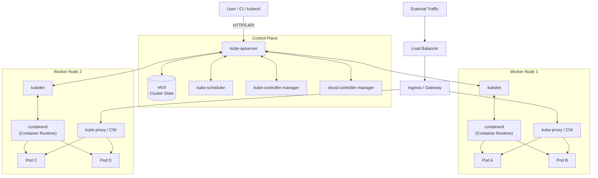
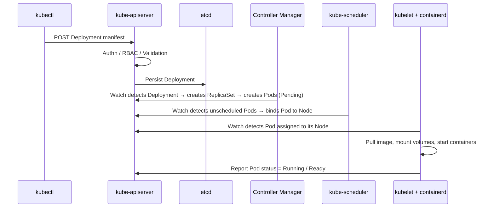

# Kubernetes Architecture Guide

A clean visual and conceptual breakdown of Kubernetes internals, request lifecycles, production HA design, and how K3s compares.

---

## 1. High-Level Cluster Architecture



---

## 2. Control Plane Components (The Brain)

The Control Plane makes global decisions (scheduling, scaling, healing) and stores desired cluster state.

| Component | Role |
| :--- | :--- |
| **`kube-apiserver`** | Front door for all cluster operations (`kubectl`, controllers, kubelets). Handles authn/authz (RBAC), admission webhooks, and validation. Only component that talks directly to `etcd`. |
| **`etcd`** | Distributed, strongly consistent key-value store holding all cluster state (Deployments, Pods, Secrets, ConfigMaps). Requires odd node counts (3 or 5) in HA production. |
| **`kube-scheduler`** | Watches for newly created unscheduled Pods and selects the best Worker Node based on CPU/memory requests, taints/tolerations, affinity rules, and topology spread. |
| **`kube-controller-manager`** | Runs reconciliation loops (Node, Deployment, ReplicaSet, Endpoint, Job controllers) that continuously drive **actual state → desired state**. |
| **`cloud-controller-manager`** | Integrates with cloud provider APIs (provisioning LoadBalancers, node routes, and cloud volumes). Optional on bare-metal/on-prem. |

---

## 3. Worker Node Components (The Muscle)

Worker nodes run your actual application workloads (Pods).

| Component | Role |
| :--- | :--- |
| **`kubelet`** | Node agent running on every worker. Talks to `kube-apiserver`, watches Pods assigned to its node, instructs the container runtime to start/stop containers, runs liveness/readiness probes, and reports node health. |
| **Container Runtime (`containerd` / `CRI-O`)** | Pulls container images from registries and manages container lifecycle via the Container Runtime Interface (CRI). |
| **`kube-proxy`** | Maintains network rules (`iptables` / `IPVS`) on each node so Kubernetes `Service` virtual IPs route traffic to healthy backend Pods. *(Often replaced by eBPF in Cilium.)* |
| **Pod** | Smallest deployable unit—one or more tightly coupled containers sharing a network namespace (same IP) and storage volumes. |

---

## 4. Essential Cluster Add-ons

A production cluster also relies on these core add-ons:

- **CNI Plugin (Flannel, Calico, Cilium):** Provides Pod-to-Pod networking across nodes and enforces `NetworkPolicy` firewall rules.
- **CoreDNS:** Internal cluster DNS resolving `<service>.<namespace>.svc.cluster.local` to Service ClusterIPs.
- **Ingress Controller / Gateway API (NGINX, Traefik, Envoy):** Handles L7 HTTP/HTTPS routing, TLS termination, host/path rules, and rate limiting.
- **CSI Driver (Container Storage Interface):** Dynamically provisions persistent volumes (EBS, Ceph, Longhorn, NFS).
- **Metrics Server:** Collects CPU/memory metrics from kubelets for `kubectl top` and `HorizontalPodAutoscaler` (HPA).

---

## 5. Key Lifecycle Flows

### A. Control Plane Flow: `kubectl apply -f deployment.yaml`



### B. Data Plane Flow: Incoming Production Request

```text
Internet Client
  → Cloud / MetalLB Load Balancer (L4 TCP)
    → Ingress Controller / Gateway (L7 HTTPS + TLS termination + Path/Host routing)
      → Kubernetes Service (ClusterIP / iptables or eBPF load balancing)
        → Ready Pod Endpoint (Container listening on targetPort)
```

---

## 6. Production HA Architecture Best Practices

- **Control Plane HA:** Run **3 (or 5) Control Plane nodes** spread across Availability Zones/racks with a Load Balancer in front of `kube-apiserver` (port `6443`).
- **Worker Node Pools:** Separate workloads using node pools/taints (e.g., general apps, memory-heavy DBs/caches, monitoring stack).
- **etcd Backups:** Schedule automated `etcdctl snapshot save` backups to off-cluster object storage and regularly test restores.
- **Network Isolation:** Use default-deny `NetworkPolicy` per namespace, allowing only required service-to-service traffic.
- **Zero-Trust Security:** Enforce RBAC least privilege, Pod Security Standards (`restricted`), non-root containers, and TLS everywhere (cert-manager + optional Service Mesh like Cilium/Istio/Linkerd).

---

## 7. Standard Kubernetes vs. K3s Architecture

Since K3s is a CNCF-certified lightweight Kubernetes distribution, it keeps the exact same API and concepts while packaging components efficiently:

| Layer | Standard Kubernetes | K3s |
| :--- | :--- | :--- |
| **Control Plane** | Separate static pods/binaries (`apiserver`, `scheduler`, `controller-manager`) | Packaged into a **single `k3s server` binary** |
| **Datastore** | `etcd` cluster | Embedded **SQLite** (single-node), **embedded etcd** (HA), or external Postgres/MySQL |
| **Container Runtime** | `containerd` / `CRI-O` (installed separately) | Bundled **`containerd`** |
| **Default CNI** | Must install manually | Bundled **Flannel** (replaceable with Calico/Cilium) |
| **Default Ingress** | Must install manually | Bundled **Traefik** (replaceable with NGINX/Gateway API) |
| **Default LB** | Cloud LB / MetalLB | Bundled **ServiceLB (Klipper)** (replaceable with MetalLB) |
