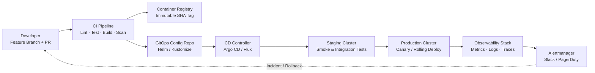

# Production Workflow: Microservices, CI/CD & Monitoring

A clean, battle-tested blueprint for building, deploying, and observing microservices in production (Kubernetes / K3s + Docker).

---

## 1. End-to-End Flow



---

## 2. Microservices Production Standards

Before automating delivery, every microservice should follow a consistent contract:

### Service Contract
- **Stateless containers:** Store state in managed DBs, Redis, or object storage—never local container disk.
- **Immutable artifacts:** Build once, promote the exact same image digest (`app:sha-a1b2c3d`) across `dev → staging → prod`. Never use `:latest`.
- **12-Factor config & secrets:** Inject non-sensitive config via `ConfigMap` / env vars; manage secrets with **External Secrets Operator** (Vault / AWS Secrets Manager / GCP Secret Manager) or **Sealed Secrets**.
- **Health endpoints:**
  - `/health/live` (livenessProbe) — is the process deadlocked?
  - `/health/ready` (readinessProbe) — can it serve traffic (DB/dependencies reachable)?
  - `/metrics` — Prometheus metrics endpoint.
- **Graceful shutdown:** Handle `SIGTERM` — stop accepting new requests, finish in-flight requests, close DB connections cleanly.
- **Resilience & limits:** Set `resources.requests` & `resources.limits`, `HorizontalPodAutoscaler` (HPA), and `PodDisruptionBudget` (PDB).

### Recommended Repo Layout
- **App repos** (one per service or monorepo): source code, `Dockerfile`, unit tests, CI workflow.
- **GitOps/Infra repo** (separate): Helm charts or Kustomize overlays per environment:
  ```text
  gitops-repo/
  ├── base/
  │   └── order-service/
  └── overlays/
      ├── dev/
      ├── staging/
      └── prod/
  ```

---

## 3. CI Pipeline (Continuous Integration)

Runs on every **Pull Request** and on merge to `main` (GitHub Actions / GitLab CI).

### Stage 1: Pull Request Checks (Fast Feedback, < 5 min)
1. **Lint & Format:** Code style, `hadolint` (Dockerfile), `kubeconform` / `helm lint` (manifests).
2. **Unit & Contract Tests:** Run isolated tests + API schema validation (OpenAPI / Protobuf).
3. **Security Scans (SAST & Dependencies):** Scan source code and lockfiles (e.g., Semgrep, Trivy fs, Dependabot/Renovate).

### Stage 2: Merge to `main` (Build & Publish)
1. **Multi-stage Docker Build:** Minimal runtime image (distroless / alpine), non-root `USER`.
2. **Container Vulnerability Scan:** Fail build on `CRITICAL` CVEs (`trivy image --exit-code 1`).
3. **Tag & Push:** Push with immutable Git SHA tag (`registry/order-service:sha-9f8e7d6`).
4. **Sign & SBOM (Recommended):** Sign image with Cosign and attach SBOM.
5. **Update GitOps Repo:** Automatically bump the image tag in `overlays/dev` (and open a promotion PR for `staging`/`prod`).

---

## 4. CD Pipeline (Continuous Delivery via GitOps)

Use a pull-based GitOps controller (**Argo CD** or **Flux**) so Git is always the single source of truth.

### Environment Promotion Flow
1. **Dev (Auto-sync):** Merges to `main` automatically deploy to `dev`.
2. **Staging (Auto or PR-gated):** Promote verified image tag to `overlays/staging` → run automated integration, E2E, and smoke tests.
3. **Production (Approval / Progressive Delivery):**
   - Merge promotion PR to `overlays/prod`.
   - **Deployment Strategy:**
     - **Rolling Update** (default): Zero-downtime with `maxUnavailable: 0`, `maxSurge: 1` + proper `readinessProbe`.
     - **Canary** (Argo Rollouts / Flagger): Shift traffic `5% → 25% → 50% → 100%`, automatically aborting if error rate or p95 latency breaches thresholds.
     - **Blue/Green:** Run new version alongside old, switch Service/Ingress traffic atomically.

### Safe Database Migrations
- Always use **Expand & Contract** (backward-compatible) schema changes so old and new service versions can run simultaneously during rollouts.
- Run migrations as a pre-deploy **Kubernetes Job** (or Argo CD `PreSync` hook), never inside the app's startup loop across multiple replicas.

### Rollback
- **GitOps Rollback:** `git revert` the tag bump commit in the GitOps repo → Argo CD reconciles automatically.
- **Emergency Rollback:** `kubectl rollout undo deploy/<svc> -n prod` (then sync Git to match).

---

## 5. Monitoring & Observability Stack

Instrument every microservice for the **Three Pillars** using **OpenTelemetry (OTel)** as the single collection standard.

### The Three Pillars

| Pillar | What It Answers | Recommended Stack |
| :--- | :--- | :--- |
| **Metrics** | *Is the system healthy? What is trending up/down?* | **Prometheus** + **Grafana** + **Alertmanager** |
| **Logs** | *What exact error happened in this request?* | **Structured JSON logs** → **OTel Collector / Promtail** → **Grafana Loki** |
| **Traces** | *Which microservice caused the 2s latency?* | **OpenTelemetry SDK** → **OTel Collector** → **Grafana Tempo** / **Jaeger** |

### What to Monitor (Golden Signals + Infrastructure)
1. **Service-level (RED Method):**
   - **Rate:** Requests per second (RPS) per endpoint/service.
   - **Errors:** 5xx / failed request percentage.
   - **Duration:** Latency percentiles (`p50`, `p95`, `p99` — never rely on averages alone).
2. **Infrastructure-level (USE Method):**
   - **Utilization:** CPU, memory, disk, network bandwidth.
   - **Saturation:** CPU throttling, OOMKills, queue depth, DB connection pool exhaustion.
   - **Errors:** Node `NotReady`, pod `CrashLoopBackOff`, DNS failures, TLS cert expiry.

### Logging Best Practices
- Log to **`stdout`/`stderr`** in **JSON** format (let the cluster agent ship logs).
- Include correlation fields on every log line: `timestamp`, `level`, `service`, `trace_id`, `request_id`, `http_status`, `latency_ms`.
- Never log PII, passwords, tokens, or API keys.

### Alerting Strategy (Avoid Alert Fatigue)
- **Page only on symptoms** (user-facing SLO burn, high 5xx rate, service down, disk > 90% filling fast)—not noisy causes like a brief CPU spike.
- **Severity tiers:**
  - `Critical` (PagerDuty/On-call): User impact right now or imminent outage.
  - `Warning` (Slack channel): Needs attention during business hours.
- Attach a **runbook link** and **Grafana dashboard link** to every alert rule.

---

## 6. Production Readiness Checklist

- [ ] Multi-stage, non-root `Dockerfile` with immutable SHA image tags
- [ ] CI runs unit tests, lint, SAST, and container CVE scan before push
- [ ] `livenessProbe`, `readinessProbe`, and graceful `SIGTERM` handling configured
- [ ] CPU/memory `requests` & `limits`, HPA, and PDB set on all workloads
- [ ] Secrets stored externally (never committed to Git)
- [ ] Backward-compatible DB migration strategy (Expand & Contract)
- [ ] Structured JSON logs with `trace_id` propagation across services
- [ ] Dashboards for RED metrics (Rate, Errors, p95/p99 Duration) + cluster health
- [ ] Actionable alerts configured for 5xx spikes, OOMKills, CrashLoopBackOff, disk pressure, and cert expiry
- [ ] Tested rollback procedure (GitOps revert / `kubectl rollout undo`)
